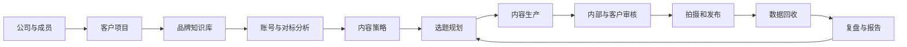
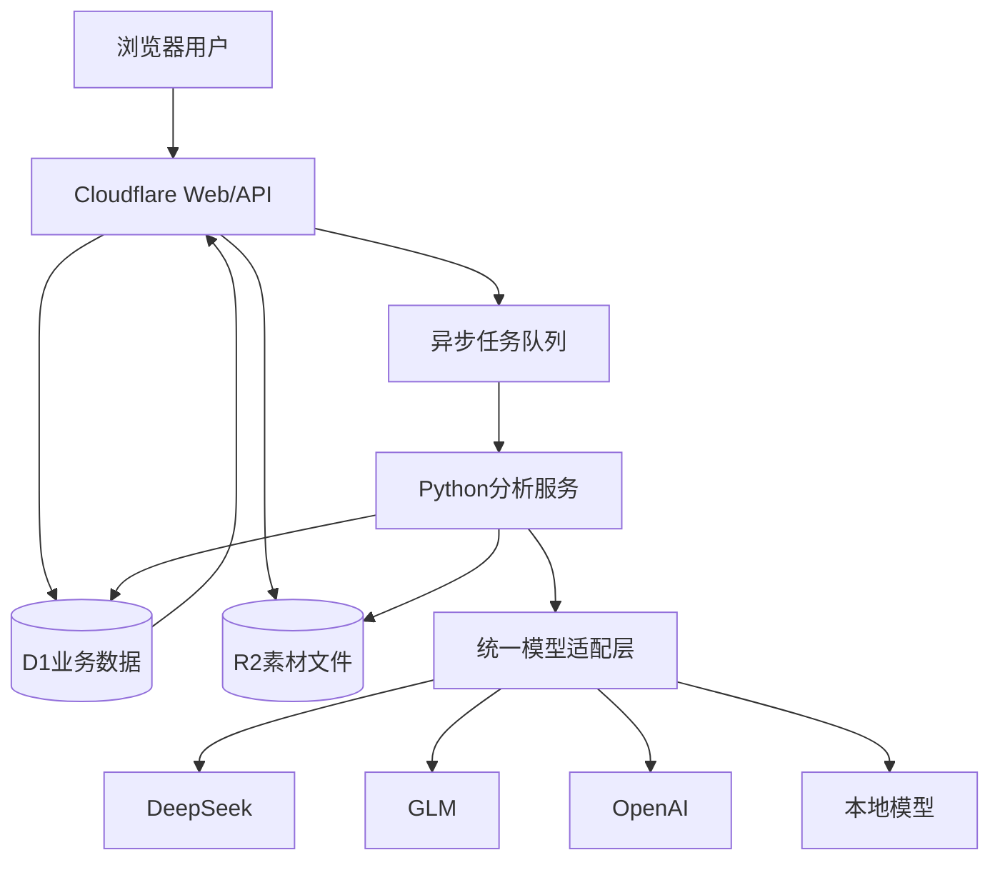

# 利明智耀 AI 新媒体内容运营协作平台

> 项目施工说明（V1.0）  
> 编制日期：2026-08-05  
> 项目目录：`E:\利明智耀AI`  
> 旧项目参考目录：`E:\抖音账号视频分析2.0`

---

## 1. 文档目的

本文档用于统一产品、设计、前端、后端、算法、测试和部署工作的施工标准，避免项目在开发过程中退化为单一的“抖音文案分析工具”。

本文档定义：

- 产品定位与服务对象；
- 第一版建设范围与非目标；
- 完整业务流程；
- 功能模块和页面结构；
- 系统架构与技术边界；
- 数据模型与成员权限；
- 视频分析、Python计算和大模型之间的职责；
- Cloudflare公网部署方案；
- 开发阶段、验收标准和风险控制。

旧项目 `E:\抖音账号视频分析2.0` 仅作为正式开发阶段的业务参考。调研旧项目时应重点提取可复用的业务规则、提示词和样例，不默认继承其代码结构、数据库设计或页面交互。

---

## 2. 项目结论

本项目方向成立，具备明确的客户、使用场景和可持续价值。

项目不能被定义为“调用大模型分析视频”，更准确的定位是：

> 面向新媒体服务公司和企业新媒体部门，以客户知识库为基础，以账号及对标内容分析为输入，以选题、内容生产和团队审核为工作过程，以发布数据复盘为反馈的 AI 新媒体内容运营协作平台。

核心价值不是单次生成文案，而是帮助团队持续完成：

```text
分析过去
→ 决定拍什么
→ 生成可执行内容
→ 团队与客户审核
→ 发布并回收数据
→ 复盘效果
→ 优化下一轮选题
```

---

## 3. 产品目标

### 3.1 业务目标

1. 降低对标账号和视频的人工研究成本；
2. 缩短从客户资料到选题、口播稿的生产时间；
3. 统一团队与客户之间的审核流程；
4. 将发布结果与选题、文案结构建立关联；
5. 自动形成周报、月报和下一周期建议；
6. 将服务过程沉淀为公司可复用的数据资产和方法库；
7. 通过公网系统支持跨地点、跨角色团队协作。

### 3.2 产品原则

- **事实可追溯**：数据、文案和结论保留来源与采集时间；
- **计算确定性**：统计计算交给程序，不依赖大模型心算；
- **模型可替换**：GLM、DeepSeek、OpenAI或本地模型均可接入；
- **数据强隔离**：不同客户之间的数据不可互相访问；
- **流程可协作**：所有内容都有负责人、状态、审核和版本；
- **结果能闭环**：分析结果必须能够进入选题和内容生产；
- **先跑通再扩展**：首版优先完成最小闭环，不堆积低优先级功能。

---

## 4. 服务对象与角色

### 4.1 服务对象

#### 新媒体服务公司

同时管理多个企业客户，内部包含项目经理、策划、文案、拍摄剪辑和运营人员，并需要让客户参与审核。

#### 企业新媒体部门

围绕一个或多个品牌完成竞品研究、选题、生产、审批、发布和复盘。

### 4.2 系统角色

| 角色 | 作用 |
|---|---|
| 平台管理员 | 管理整个平台、公司、系统配置和异常任务 |
| 公司管理员 | 管理本公司成员、客户项目和模型配置 |
| 项目负责人 | 管理指定客户项目、任务和审核流程 |
| 策划/文案 | 分析内容、创建选题、编辑脚本 |
| 审核人 | 审批、驳回和提出修改意见 |
| 客户成员 | 查看自己的项目、评论和参与审核 |
| 只读成员 | 查看被授权的内容与报告，不可修改 |

角色分为公司级角色和项目级角色。同一成员可以参与多个客户项目，并在不同项目中拥有不同角色。

---

## 5. 总体业务流程



典型周工作流：

1. 系统更新客户账号和对标账号数据；
2. 自动提示值得关注的视频、话题和评论需求；
3. 策划确认本周选题；
4. 系统生成口播稿和拍摄生产包；
5. 内部审核后提交客户；
6. 客户通过或驳回并留下意见；
7. 拍摄、剪辑并记录发布链接；
8. 系统按时间节点回收数据；
9. 自动复盘并推荐下一轮选题。

---

## 6. 功能模块

### 6.1 用户、公司与成员管理

首版功能：

- 注册、登录和退出；
- 创建公司；
- 邮箱邀请成员；
- 接受、拒绝和撤销邀请；
- 设置公司级角色；
- 将成员分配到客户项目；
- 设置项目级角色；
- 暂停、恢复或移除成员；
- 查看成员最近活动；
- 记录关键操作日志。

安全要求：

- 权限必须由服务端判断，不能只隐藏前端按钮；
- 用户访问任何业务数据时，必须校验公司和项目归属；
- 邀请链接必须有有效期且只能使用一次；
- 被移除成员的历史操作记录不得丢失。

### 6.2 客户项目管理

每个客户使用独立项目空间，保存：

- 公司、品牌和产品信息；
- 服务周期；
- 目标平台和账号；
- 内容产量目标；
- 曝光、涨粉、获客或成交目标；
- 客户联系人；
- 内部项目负责人；
- 项目成员；
- 项目状态；
- 客户专属模型和生成规则。

### 6.3 品牌知识库

支持录入或上传：

- 公司介绍；
- 产品与服务资料；
- 品牌定位和目标人群；
- 创始人或出镜人经历；
- 成功案例；
- 常见客户问题；
- 销售和客服话术；
- 历史优质文案；
- 行业术语；
- 禁用词和合规要求；
- 品牌语气；
- 客户反馈和修改偏好。

要求：

- 每条资料保存来源、创建者、更新时间和版本；
- AI生成内容应能标明引用了哪些知识；
- 客户修改不能直接污染知识库，应经过确认后沉淀为规则；
- 支持按项目隔离和检索。

### 6.4 账号与对标内容库

支持：

- 添加客户自己的账号；
- 添加对标账号；
- 粘贴单条抖音视频链接；
- 批量导入链接；
- 上传本地视频；
- 收藏视频到行业样本库；
- 设置标签和分析状态。

单条视频需要保存：

- 原始链接、平台和作品ID；
- 原始视频和音频；
- 标题、作者、发布时间和话题；
- 视频规格；
- 互动数据及采集时间；
- 文案和时间轴；
- 画面字幕；
- 关键帧；
- 评论样本；
- 结构化分析结果；
- 处理过程和错误信息。

### 6.5 视频分析引擎

分析内容分为六层：

1. **基础层**：作者、标题、标签、时长、发布时间、互动量；
2. **文案层**：逐字稿、钩子、痛点、观点、证据、案例和CTA；
3. **表达层**：语速、停顿、句长、口语化、情绪和信息密度；
4. **视觉层**：封面、字幕、人物、场景、镜头变化和产品展示；
5. **效果层**：点赞、评论、收藏、分享、增长速度和评论需求；
6. **复用层**：内容类型、目标人群、结构公式、复刻难度和风险。

分析结果必须同时输出：

- 可读报告；
- 结构化JSON；
- 证据和时间点；
- 置信度；
- 可复用内容公式；
- 可进入选题中心的建议。

### 6.6 批量数据分析

支持对账号、标签或一组视频进行统计：

- 高表现选题；
- 内容类型分布；
- 钩子类型分布；
- 视频时长分布；
- 高频关键词；
- 收藏率、分享率和评论率；
- 评论区需求聚类；
- 发布频率和时间分布；
- 客户与对标账号差异；
- 尚未覆盖的内容机会。

所有比率、排序、均值、中位数、异常值和趋势由Python计算，大模型只解释结果。

### 6.7 内容策略

根据客户知识、历史数据和对标分析形成：

- 账号定位；
- 人设定位；
- 目标人群；
- 用户痛点；
- 内容支柱；
- 选题比例；
- 内容风格；
- 更新频率；
- 转化路径；
- 阶段性目标。

内容策略需要版本管理，并记录启用时间，便于判断策略调整前后的效果。

### 6.8 选题中心与内容日历

选题来源：

- 品牌知识库；
- 对标视频；
- 历史高表现内容；
- 行业热点；
- 评论区问题；
- 销售和客服反馈；
- 人工录入。

选题字段：

- 标题和核心观点；
- 推荐理由；
- 目标用户和痛点；
- 内容目标；
- 参考视频；
- 推荐钩子；
- 预计时长；
- 拍摄难度；
- 风险提示；
- 负责人；
- 计划发布时间；
- 当前状态。

### 6.9 AI内容生产

确认选题后生成：

- 多种开头；
- 完整口播稿；
- 精简版和完整版；
- 分镜脚本；
- 表情、动作、停顿和重音提示；
- 画面素材建议；
- 字幕重点；
- 封面文案；
- 发布标题和话题；
- 评论区引导话术；
- 其他平台改编版本。

生成依据必须包含：

```text
客户品牌知识
+ 内容策略
+ 对标内容方法
+ 平台特点
+ 历史发布数据
+ 客户修改偏好
```

系统复用结构和方法，不做简单近义词洗稿。

### 6.10 内容审核与协作

首版状态流：

```text
草稿
→ 内部修改
→ 内部审核
→ 客户审核
→ 待拍摄
→ 已拍摄
→ 待剪辑
→ 待发布
→ 已发布
→ 已复盘
```

支持：

- 设置负责人和截止时间；
- 评论、回复和@成员；
- 通过、驳回和撤回；
- 查看修改前后差异；
- 保存每个版本；
- 记录审核人、审核时间和理由；
- 将确认后的客户意见转为品牌规则。

### 6.11 素材管理

管理：

- 原始视频；
- 成片；
- 音频；
- 图片和封面；
- 字幕文件；
- 文案和脚本；
- 关键帧；
- 客户资料；
- 历史版本。

所有素材都必须归属于公司和项目，并可关联到账号、视频、选题或内容任务。

### 6.12 发布管理

首版支持：

- 发布计划；
- 发布任务提醒；
- 文案复制和素材下载；
- 发布链接回填；
- 实际发布时间；
- 发布负责人；
- 发布状态；
- 失败原因记录。

自动发布列为后续能力，需要根据平台授权和合规条件单独评估。

### 6.13 数据回收与复盘

为每条已发布内容记录：

- 发布后1小时；
- 发布后6小时；
- 发布后24小时；
- 发布后3天；
- 发布后7天。

数据包括播放、点赞、评论、收藏、分享、涨粉、主页访问、线索和成交。公开数据与客户后台数据必须标明来源。

复盘回答：

- 哪类选题表现最好；
- 哪类钩子更容易获得播放；
- 哪类结构收藏率更高；
- 什么时长更适合当前账号；
- 哪些内容能涨粉或带来咨询；
- 哪些表达经常被客户修改；
- 哪些对标方法适用于客户；
- 下一周期应该增加或减少什么。

### 6.14 报告中心

自动生成：

- 项目周报；
- 项目月报；
- 内容完成情况；
- 账号数据变化；
- 高表现内容；
- 评论区用户需求；
- 对标账号动态；
- 下阶段计划；
- 待客户确认事项。

报告支持网页查看和导出，必须同时展示结果与服务过程。

---

## 7. 系统架构

### 7.1 架构原则

Cloudflare负责公网访问、业务接口、权限、数据和任务调度；Python分析服务负责视频、音频、OCR、ASR和统计等计算密集型任务。

禁止在一次普通网页请求中同步完成视频下载、转写、OCR和大模型分析。

### 7.2 建议架构



### 7.3 组件职责

| 组件 | 职责 |
|---|---|
| Cloudflare Web/API | 页面、接口、身份、权限、任务创建和结果展示 |
| D1 | 用户、公司、项目、内容、权限、任务和报告数据 |
| R2 | 视频、音频、关键帧、字幕、资料和报告文件 |
| Queue | 解耦网页请求与长时间分析任务 |
| Python服务 | 下载、FFmpeg、ASR、OCR、OpenCV、统计、聚类和报告数据加工 |
| 模型适配层 | 统一调用不同大模型并校验结果 |

### 7.4 分析任务状态

```text
pending      已创建
queued       已进入队列
downloading  正在获取媒体
processing   正在处理音视频
transcribing 正在转写
extracting   正在提取画面与字幕
analyzing    正在执行统计和语义分析
completed    已完成
failed       失败
cancelled    已取消
```

任务必须支持：

- 进度展示；
- 阶段性结果；
- 超时；
- 可重试；
- 幂等处理；
- 错误码和可读错误信息；
- 同一视频的结果缓存。

---

## 8. Python与大模型职责

### 8.1 Python负责

- 文件下载和校验；
- FFmpeg音视频处理；
- ASR调用和时间轴整理；
- OCR和字幕去重；
- 镜头变化、关键帧和画面特征；
- 数据清洗和格式统一；
- 字数、语速和句长；
- 点赞率、收藏率、分享率和评论率；
- 均值、中位数、分布和异常值；
- 相似度、去重和评论聚类；
- 图表数据和报告数据；
- JSON校验、重试和缓存。

### 8.2 大模型负责

- 目标受众判断；
- 痛点和价值主张；
- 钩子和叙事结构；
- 观点、证据和CTA识别；
- 评论需求的商业解释；
- 跨视频内容洞察；
- 可复用内容公式；
- 内容策略；
- 口播稿和分镜创作；
- 复盘建议。

### 8.3 混合任务

以评论分析为例：

```text
Python清洗和去重
→ 向量化与聚类
→ 提取代表性评论
→ 大模型命名类别并解释
→ Python统计数量和占比
```

禁止把大量原始评论直接无筛选地提交给大模型。

---

## 9. 多模型适配

业务模块禁止直接绑定某一家模型SDK，必须经过统一模型接口。

统一请求至少包含：

```json
{
  "task_type": "analyze_hook",
  "input": {},
  "output_schema": {},
  "model_profile": "fast",
  "project_id": "..."
}
```

模型档位：

- `fast`：提取、分类、标签和短摘要；
- `standard`：单条视频结构分析和普通内容生成；
- `advanced`：跨视频洞察、策略和高质量创作；
- `local`：离线或隐私敏感场景。

输出保护：

1. JSON Schema约束；
2. 程序字段校验；
3. 格式自动修复；
4. 失败重试；
5. 模型降级；
6. 无法判断时返回`unknown`和置信度；
7. 保存模型、版本、提示词版本和调用耗时。

目标标准：更换大模型后，基础数据、统计结果和处理流程保持稳定；允许策略解释和创作质量存在差异。

---

## 10. 数据模型草案

核心表建议：

```text
users
organizations
organization_members
projects
project_members
invitations
brand_documents
brand_rules
social_accounts
benchmark_accounts
videos
video_metric_snapshots
video_transcripts
video_frames
video_comments
video_analyses
content_strategies
topics
content_items
content_versions
content_comments
approval_records
assets
publish_records
performance_snapshots
reports
analysis_jobs
model_calls
notifications
audit_logs
```

所有核心业务表至少包含：

```text
id
organization_id
project_id（适用时）
created_by
created_at
updated_by
updated_at
```

### 10.1 数据隔离

每次业务查询必须同时限制`organization_id`，项目数据还必须限制`project_id`。文件存储也要使用对应前缀：

```text
organizations/{organization_id}/projects/{project_id}/...
```

禁止使用前端传入的公司或项目ID作为唯一信任来源，服务端必须依据当前登录用户的成员关系重新判断。

### 10.2 删除策略

- 成员移除采用状态停用，保留历史操作；
- 内容和项目优先软删除；
- 文件物理删除需要异步执行并保留日志；
- 删除客户项目前必须显示影响范围并二次确认。

---

## 11. 页面与导航草案

### 公共页面

- 登录；
- 注册；
- 接受邀请；
- 忘记密码；
- 无权限页面。

### 登录后页面

- 工作台；
- 客户项目；
- 品牌知识库；
- 客户账号；
- 对标内容库；
- 视频分析；
- 内容策略；
- 选题中心；
- 内容日历；
- 内容生产；
- 审核中心；
- 素材中心；
- 发布管理；
- 数据复盘；
- 报告中心；
- 成员与权限；
- 系统设置。

### 工作台首屏

工作台不应以空白AI输入框为核心，应优先展示：

- 今日待办；
- 待审核内容；
- 逾期任务；
- 对标账号新内容；
- 异常增长视频；
- 本周内容进度；
- 最近分析任务；
- 系统生成的下一步建议。

---

## 11.1 UI设计与Appica UI使用规范

### 11.1.1 视觉目标

本项目UI关键词：

```text
简约、克制、专业、高级、清晰、可信、低学习成本
```

产品属于长期使用的内容运营工作台，不采用大面积渐变、玻璃拟态、发光边框或无意义动画制造“AI感”。高级感主要来自：

- 清晰的信息层级；
- 稳定的网格和对齐；
- 充足但不过度的留白；
- 克制的颜色数量；
- 统一的圆角、阴影和边框；
- 准确、及时的状态反馈；
- 高质量的数据表格和图表。

### 11.1.2 Appica UI定位

项目允许并建议使用 [Appica UI](https://appica.dev/ui/docs/react/installation) 作为React基础组件系统。

Appica UI负责按钮、表单、菜单、导航、表格、弹层、状态反馈、主题和无障碍交互。业务页面、数据图表、视频时间轴、文案结构图和分析报告仍需按照本项目需求组合或开发，不得将官网组件演示页直接拼接成最终产品。

采用原则：

- 优先使用Appica UI已有组件；
- 通过设计令牌统一品牌颜色、字体、圆角和阴影；
- 业务代码优先使用组件子路径导入，控制前端包体积；
- 不直接修改第三方包内部源码；
- 需要扩展时，在项目`packages/ui`中封装业务组件；
- 正式发布前确认并记录依赖版本、许可证和升级策略；
- 使用锁文件固定经过测试的版本，禁止生产环境自动漂移版本。

### 11.1.3 技术前提与安装

根据Appica UI当前安装要求，前端技术栈至少满足：

```text
React >= 19
React DOM >= 19
Tailwind CSS >= 4.0
```

安装：

```bash
pnpm add @appica/ui-react
```

全局样式文件需要先导入Tailwind，再导入Appica UI设计令牌，并让Tailwind扫描组件包：

```css
@import 'tailwindcss';
@import '@appica/ui-react/styles.css';

@source '../node_modules/@appica/ui-react/dist';
```

`@source`路径必须按照全局样式文件与`node_modules`之间的真实相对位置设置。缺失或路径错误会导致组件存在但没有完整样式。

应用根节点使用`ThemeProvider`，以支持明暗模式、主题记忆和首屏主题防闪烁：

```tsx
import { ThemeProvider } from '@appica/ui-react/providers/theme-provider'

export function AppRoot({ children }: { children: React.ReactNode }) {
  return <ThemeProvider>{children}</ThemeProvider>
}
```

业务代码使用子路径导入：

```tsx
import { Button } from '@appica/ui-react/button'
import { Input } from '@appica/ui-react/input'
import { Badge } from '@appica/ui-react/badge'
```

不建议在正式业务代码中长期使用包根部批量导入。

### 11.1.4 设计令牌与视觉方向

Appica UI通过CSS变量提供颜色、圆角、字体、阴影以及明暗主题。项目应覆盖原始设计令牌，不修改派生令牌。

| 类别 | 第一版建议 |
|---|---|
| 页面背景 | 暖灰白或极浅中性灰，避免纯白铺满全屏 |
| 内容表面 | 白色或接近白色，以细边框区分层级 |
| 主文字 | 接近黑色的中性炭黑 |
| 次要文字 | 中性灰，并保证可读对比度 |
| 主色 | 深靛蓝或偏冷蓝紫，仅用于主操作和选中状态 |
| 成功 | 低饱和绿色 |
| 警告 | 低饱和琥珀色 |
| 错误 | 克制的红色，不用于普通装饰 |
| 圆角 | 以10至14px为主，不使用过大的胶囊圆角铺满页面 |
| 阴影 | 轻量，优先使用边框和背景层级 |

第一版优先完成亮色主题，同时建立暗色主题令牌。暗色模式不是简单反色，需要单独检查表格、图表、视频播放器和文案对比区域。品牌主色最终通过视觉稿确认，不在施工初期把具体色值散落到业务组件中。

### 11.1.5 字体与排版

- 中文优先使用清晰的系统无衬线字体栈；
- 正文不使用过细字重；
- 页面标题、模块标题、正文、辅助文字和数字指标形成固定层级；
- 数据指标使用等宽数字特性，避免数字变化导致界面跳动；
- 正文推荐14至16px；
- 表格和辅助信息可使用13至14px；
- 页面主标题不追求超大字号；
- 长文案和转写稿保持舒适行高，并支持段落、时间轴和证据高亮。

### 11.1.6 整体布局

桌面端采用：

```text
顶部全局栏
+ 左侧主导航
+ 中间主工作区
+ 按需出现的右侧详情/评论面板
```

建议尺寸：

- 顶部栏约56至64px；
- 展开侧栏约224至248px；
- 收起侧栏约64至72px；
- 页面主要间距以8px为基础单位；
- 普通内容区使用24至32px外边距；
- 数据密集页面允许全宽，但必须保持列对齐；
- 表单和阅读型页面限制最大内容宽度，避免超长行。

移动端第一版以查看、评论、审核和简单操作为主，不要求在手机上完整复刻桌面端的视频批量分析体验。

### 11.1.7 Appica UI组件映射

| 项目场景 | 推荐基础组件 |
|---|---|
| 主操作、次操作和危险操作 | Button、Button Group |
| 登录、邀请和项目资料 | Form、Input及相关表单组件 |
| 左侧导航和项目切换 | Navigation、Navigation Menu |
| 页面位置提示 | Breadcrumb |
| 内容状态、角色和标签 | Badge |
| 成员信息 | Avatar、Badge、Table |
| 成员和视频列表 | Table、Pagination、Dropdown Menu |
| 多视图切换 | Tabs或Button Group |
| 筛选与检索 | Input、Select、Combobox、Popover |
| 新建和编辑 | Dialog或侧边详情面板 |
| 删除确认 | Dialog，并明确显示影响范围 |
| 操作菜单 | Dropdown Menu |
| 简短解释 | Tooltip |
| 异步分析状态 | Progress、Spinner和状态反馈组件 |
| 开关配置 | Switch |
| 空状态和错误 | Alert、空状态业务组件 |
| 长列表和面板 | Scroll Area |

具体组件以开发时Appica UI实际稳定发布的目录为准。若某个组件不存在或不符合业务要求，应在`packages/ui`中封装替代实现，不得伪造不存在的API。

### 11.1.8 核心页面视觉要求

#### 工作台

- 首屏突出待办、待审核和异常项；
- 指标卡不超过首屏视觉重点的四至六个；
- 卡片大小与重要性相关，不做平均分配；
- 趋势信息优先于纯累计数字；
- AI建议以可执行任务呈现，不以聊天气泡作为整个产品中心。

#### 视频分析页

建议组合：

```text
视频播放器/关键帧
+ 时间轴文案
+ 结构化分析与证据
```

- 点击分析结论可以跳转到对应时间点；
- AI结论旁边显示证据、来源和置信度；
- 公开指标与客户后台指标使用不同来源标记；
- 原文、AI解释和人工修改在视觉上明确区分；
- 不使用大量彩色标签制造噪音。

#### 选题和内容生产页

- 选题列表、日历和看板可以切换；
- 编辑区突出正文，AI能力处于辅助位置；
- 参考视频和客户知识作为可展开引用区；
- 保存状态、版本和审核状态始终可见；
- 生成按钮必须明确生成范围，避免一个“AI生成”按钮承担所有行为。

#### 审核页

- 默认显示当前稿与上一版本差异；
- 通过、驳回和评论是最明确的三个动作；
- 驳回必须填写原因；
- 右侧集中展示评论和历史操作；
- 客户端界面减少内部技术字段。

#### 数据复盘页

- 图表服务于结论，不做纯装饰；
- 避免3D图表、彩虹配色和过度面积图；
- 同一指标在全系统保持相同颜色和格式；
- 图表下方提供口径、样本数和采集时间；
- 分析结论必须能转成下一轮选题或任务。

### 11.1.9 动效规范

- 动效用于解释状态变化，不用于持续吸引注意力；
- 普通悬停和弹层使用短过渡；
- 视频分析进行中使用真实阶段进度，不使用无限假进度条；
- 列表刷新避免整页闪烁；
- 支持系统`prefers-reduced-motion`设置；
- 不使用妨碍批量操作的复杂转场。

Appica UI内置动效可以保留，但需要统一速度和幅度，不能让不同页面具有互不一致的动画语言。

### 11.1.10 无障碍与可用性

- 所有按钮、菜单、弹层和表单支持键盘操作；
- 图标按钮必须设置可读标签；
- 状态不能只靠颜色表达；
- 表格使用真实表格语义和标题；
- 焦点状态必须清晰可见；
- 错误信息靠近对应字段，并可被辅助技术读取；
- 文字和背景保持足够对比度；
- 页面缩放到200%时仍可完成主要流程；
- 破坏性操作使用明确文案，不只显示“确定”。

### 11.1.11 业务组件开发边界

Appica UI解决通用交互，本项目仍需单独开发：

- 视频播放器与文案时间轴联动；
- 文案结构标注器；
- 关键帧浏览器；
- 指标快照和增长曲线；
- 评论需求聚类图；
- 内容策略比例视图；
- 选题卡和内容状态流；
- 文案版本差异；
- 审核记录时间线；
- AI结论证据块；
- 模型调用和分析任务进度面板。

这些业务组件也必须使用同一套Appica设计令牌，不建立第二套互相冲突的视觉系统。

### 11.1.12 UI验收标准

1. 所有核心页面遵循统一导航、排版和间距；
2. 明暗模式下均不存在不可读内容；
3. 常用流程不依赖鼠标悬停才能发现；
4. 键盘可以完成登录、创建项目和审核内容等核心操作；
5. 列表、空状态、加载、成功、失败和无权限状态齐全；
6. 1280px宽度下核心桌面流程无水平溢出；
7. 移动端可以完成查看、评论和审核；
8. 页面不会因大量卡片、彩色标签和阴影显得廉价或拥挤；
9. Appica UI组件只从已安装版本的公开API导入；
10. 组件升级必须通过视觉回归和核心流程测试。

---

## 12. 建议代码目录

正式选定技术栈后可调整，首版建议保持前后端与分析服务边界清晰：

```text
利明智耀AI/
├─ apps/
│  ├─ web/                  # 前端应用
│  └─ api/                  # Cloudflare API
├─ services/
│  └─ analyzer/             # Python视频与数据分析服务
├─ packages/
│  ├─ database/             # 数据模型与迁移
│  ├─ schemas/              # 前后端共享结构
│  ├─ permissions/          # 权限规则
│  ├─ model-adapter/        # 多模型适配
│  └─ ui/                   # 通用UI组件
├─ migrations/              # 数据库迁移
├─ prompts/                 # 版本化提示词
├─ tests/                   # 集成和端到端测试
├─ docs/                    # 产品和技术文档
├─ scripts/                 # 开发与部署脚本
├─ .env.example
├─ README.md
└─ 项目施工说明.md
```

---

## 13. 接口和工程规范

### 13.1 API原则

- 使用统一错误结构；
- 列表接口支持分页、排序和过滤；
- 长任务只返回任务ID，不同步等待完成；
- 创建任务需要幂等键；
- 更新重要内容使用版本号防止覆盖；
- 所有写操作记录操作者；
- 文件访问使用短期授权地址；
- 接口返回中不得泄露模型密钥和第三方临时媒体地址。

### 13.2 时间与数值

- 数据库存储UTC时间，页面按用户时区展示；
- 互动数在数据库中保存整数，不保存“2.1万”等展示字符串；
- 所有指标快照记录采集时间；
- 比率计算处理分母为零；
- 公开数据和后台数据必须标记来源。

### 13.3 提示词管理

- 提示词必须进入版本管理；
- 不在业务代码中散落长提示词；
- 每次模型调用保存提示词版本；
- 使用固定样例做回归测试；
- 提示词变更需要比较旧版和新版输出。

---

## 14. 非功能要求

### 14.1 性能

- 页面普通接口优先在1秒内返回；
- 创建分析任务后立即返回任务状态；
- 转写、OCR、关键帧等可并行执行；
- 同一视频按作品ID和文件哈希缓存；
- 页面分阶段展示元数据、文案和完整分析；
- 批量分析使用队列控制并发，避免资源耗尽。

### 14.2 稳定性

- 外部平台解析失败时支持用户上传文件；
- 模型失败不影响已完成的媒体和统计结果；
- 每个任务阶段可独立重试；
- 数据库迁移必须可追踪；
- 关键配置和密钥不得写入仓库。

### 14.3 安全

- 服务端权限校验；
- 租户数据隔离；
- 上传文件类型和大小限制；
- 媒体文件私有存储；
- 登录和邀请接口限流；
- 敏感操作日志；
- 防止提示词注入影响系统权限和外部操作；
- 不绕过平台验证码、登录限制和安全机制。

### 14.4 可观测性

至少记录：

- 请求错误；
- 任务各阶段耗时；
- 下载、ASR、OCR和模型失败率；
- 模型Token与费用；
- 队列等待时间；
- 文件存储量；
- 每公司和项目的用量；
- 权限拒绝和异常登录。

---

## 15. 测试要求

### 单元测试

- 权限规则；
- 指标计算；
- 数据清洗；
- JSON校验；
- 状态流转；
- 模型降级；
- 路径和租户隔离。

### 集成测试

- 创建公司并邀请成员；
- 创建客户项目并分配权限；
- 上传视频并完成分析；
- 创建选题和文案；
- 完成内部和客户审核；
- 回填发布链接并写入数据；
- 生成复盘和报告。

### 安全测试

- 客户A不能访问客户B；
- 只读用户不能修改；
- 被移除成员不能继续访问；
- 修改URL中的项目ID不能越权；
- 文件地址不能长期公开；
- 重复邀请和过期邀请不可使用。

### 模型回归测试

建立固定视频和文案样本集，对不同模型检查：

- JSON有效率；
- 字段完整率；
- 标签一致性；
- 事实错误；
- 分析耗时；
- 调用成本；
- 内容可用性。

---

## 16. 分阶段施工计划

### 阶段0：旧项目调研与需求冻结

交付：

- 旧项目功能和问题清单；
- 可复用与应废弃内容清单；
- 用户角色和业务流程确认；
- 第一版页面原型；
- 技术栈最终决定；
- 数据库草案。

旧项目调研必须只读进行，避免在没有明确迁移方案前直接修改。

### 阶段1：平台地基

范围：

- 登录；
- 公司和成员；
- 客户项目；
- 固定角色权限；
- 数据隔离；
- 文件存储；
- 操作日志；
- 基础工作台。

完成标准：两个测试客户的数据完全隔离，内部成员和客户成员能够按权限协作。

### 阶段2：视频分析最小闭环

范围：

- 抖音链接和视频上传；
- 媒体保存；
- ASR；
- OCR和关键帧；
- 元数据与公开指标；
- Python统计；
- 单条视频结构化分析；
- 分析报告；
- 任务状态、缓存和重试。

完成标准：输入一条公开视频链接或上传文件，可以稳定获得可追溯的结构化分析结果。

### 阶段3：知识库与内容生产

范围：

- 品牌知识库；
- 内容策略；
- 选题中心；
- 口播稿和生产包；
- 多模型适配；
- 引用来源和提示词版本。

完成标准：用户能够从分析结果直接创建选题，并结合客户知识生成可审核的口播稿。

### 阶段4：团队审核与发布管理

范围：

- 内容日历；
- 状态流；
- 评论和@成员；
- 版本对比；
- 内部审核；
- 客户审核；
- 发布链接回填。

完成标准：一条内容可以从选题经过内部与客户审核，最终记录发布结果。

### 阶段5：数据闭环

范围：

- 数据快照；
- 批量分析；
- 评论聚类；
- 自动复盘；
- 周报和月报；
- 下一轮选题建议。

完成标准：发布结果可以反向影响内容策略和下一轮选题。

### 阶段6：公网稳定运行与商业化

范围：

- Cloudflare正式环境；
- 自定义域名；
- 监控和告警；
- 备份和恢复；
- 用量统计；
- 套餐和配额；
- 隐私政策和服务条款；
- 商业化所需的组织管理能力。

---

## 17. 第一版明确不做

为控制工期，第一版暂不承诺：

- 绕过抖音登录、验证码和风控；
- 所有平台自动发布；
- 企业级复杂SSO；
- 完全自定义权限编辑器；
- 复杂财务和员工绩效；
- 自动替客户做最终商业决策；
- 用AI结果替代法务或合规审核；
- 一开始支持所有短视频平台；
- 一开始训练自有大模型。

---

## 18. 第一版验收标准

第一版可以被认为“可用”，至少需要满足：

1. 公司管理员可以邀请内部成员和客户成员；
2. 不同客户项目之间的数据严格隔离；
3. 用户可以粘贴抖音链接或上传视频；
4. 系统可以异步完成媒体处理和结构化分析；
5. 分析包含文案、时间轴、画面、互动指标、结构和复用建议；
6. 统计计算不依赖大模型；
7. DeepSeek或GLM至少有一种能够通过统一适配层稳定运行；
8. 用户可以从分析结果创建选题；
9. 用户可以根据客户知识库生成口播稿；
10. 内容可以完成内部审核和客户审核；
11. 用户可以回填发布链接和数据；
12. 系统能够生成基础复盘报告；
13. 所有关键操作有日志；
14. 分析任务失败可以重试且不会产生重复数据。

---

## 19. 主要风险

| 风险 | 应对方式 |
|---|---|
| 抖音页面和媒体规则变化 | 解析器独立封装，同时保留本地上传入口 |
| ASR或OCR准确率不足 | ASR与画面字幕交叉校正，允许人工修订 |
| 模型输出不稳定 | 结构约束、校验、重试、降级和回归测试 |
| 视频处理耗时长 | 异步队列、缓存、并行处理和阶段性展示 |
| 客户数据泄露 | 多租户隔离、服务端鉴权、私有文件和审计日志 |
| 功能范围不断膨胀 | 按施工阶段冻结需求，首版只验收核心闭环 |
| 费用失控 | 模型分档、调用缓存、用量统计和组织配额 |
| 结论看起来正确但无法执行 | 所有分析必须能进入选题、内容或复盘动作 |

---

## 20. 开工前需要最终确认的事项

1. 第一版是否只支持抖音；
2. 首批真实使用人数和客户项目数量；
3. 第一版默认使用DeepSeek还是GLM；
4. Python分析服务部署位置；
5. 是否需要邮箱登录、验证码登录或第三方登录；
6. 客户是否直接登录参与审核；
7. 第一版是否采集评论；
8. 是否需要导入客户后台数据；
9. 周报、月报的最终模板；
10. 需要保留的视频和素材周期；
11. 项目正式名称、域名和品牌视觉；
12. 首版工期和可投入开发资源。

以上事项不妨碍先进行旧项目调研、原型和数据库设计，但在进入完整功能开发前必须确认。

---

## 21. 建议的下一步

1. 只读检查 `E:\抖音账号视频分析2.0`；
2. 输出旧项目审计报告；
3. 确认第一版功能边界；
4. 绘制核心页面低保真原型；
5. 冻结数据库和权限模型；
6. 创建代码仓库和基础目录；
7. 先完成成员、项目和数据隔离；
8. 再实现单条抖音视频分析最小闭环；
9. 接入选题、内容生成和审核；
10. 最后完成数据复盘和公网部署。

本说明作为V1.0施工基线。后续重大范围、架构或权限变更，应更新本文档版本并记录变更原因。
